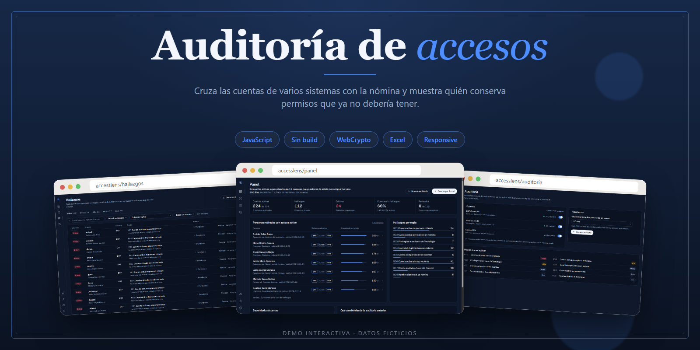
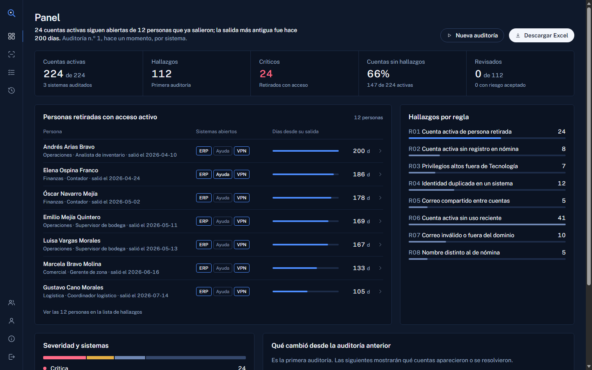
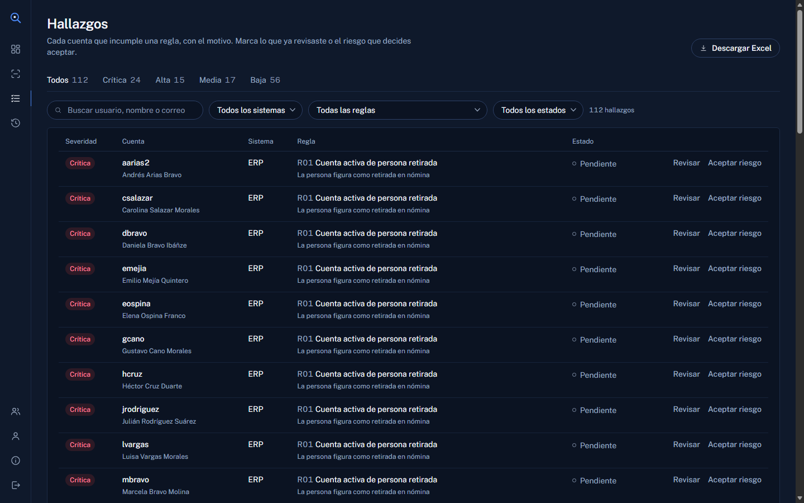
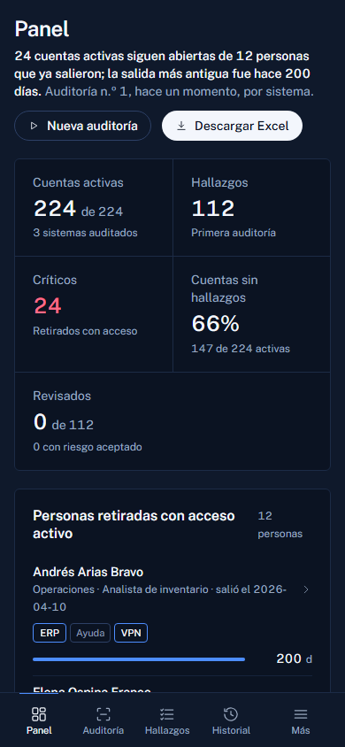

# AccessLens

Auditoría de cuentas de usuario: cruza los accesos de varios sistemas con la nómina y muestra quién conserva permisos que ya no debería tener.
*Audits user accounts across several systems against the HR roster and surfaces access that should no longer exist.*

**Demo:** https://cabrales16.github.io/AccessLens/ · Entra con un botón de acceso rápido (contraseña `Demo1234`).



## Qué resuelve

Cuando alguien sale de una empresa, sus cuentas rara vez se cierran todas a la vez: quedan abiertas en el ERP, en la mesa de ayuda o en la VPN. AccessLens toma las cuentas de tres sistemas con esquemas distintos, las normaliza, las cruza con la nómina y las ordena de lo más grave a lo menos.

El panel responde primero la pregunta importante: cuántas personas ya salieron y siguen con cuentas activas, y desde hace cuántos días.

## Qué incluye

- **Tres sistemas con esquemas distintos** (ERP, mesa de ayuda, VPN), con columnas, fechas y niveles de permiso diferentes; los conectores los llevan a un esquema común.
- **Ocho reglas**: retirados con cuentas activas, cuentas sin registro en nómina, privilegios altos fuera de Tecnología, identidades duplicadas, correos compartidos, cuentas sin uso, correos inválidos y nombres distintos al de nómina (con similitud de texto).
- **Revisión de hallazgos**: marcar como revisado o aceptar el riesgo, con filtros por severidad, sistema, regla y estado.
- **Comparación entre auditorías**: qué hallazgos aparecieron y cuáles se resolvieron.
- **Usuarios y roles** (administrador, auditor, consulta), bitácora de actividad, avisos y correos simulados.
- **Reporte en Excel** (.xlsx) generado en el navegador, con resumen, hallazgos y cuentas correctas.
- Responsive: riel de iconos en escritorio y barra inferior en el teléfono.

| Hallazgos | Móvil |
| --- | --- |
|  |  |

## Datos ficticios

Todo es inventado: las personas, los correos, el dominio (`lumen.example`) y los sistemas. Los datos se generan al abrir la app con una semilla fija, así que el resultado es siempre el mismo y no sale nada de tu equipo.

## Cómo está hecho

- HTML, CSS y JavaScript con módulos ES. Sin servidor, sin dependencias y sin paso de compilación.
- `localStorage` como base de datos del navegador; la sesión vive en `sessionStorage`.
- Contraseñas con PBKDF2-SHA256 y sal aleatoria (WebCrypto).
- Generador de `.xlsx` propio (ZIP y XML escritos a mano).
- Tipografía Public Sans autoalojada.
- Pruebas del motor y del almacén con `node:test`.

```
index.html          entrada
css/                estilos (base y tema)
js/config.js        parámetros
js/seed.js          datos sintéticos y generador pseudoaleatorio
js/connectors.js    extracción y normalización por sistema
js/rules.js         motor de reglas
js/store.js         usuarios, auditorías, revisiones, bitácora
js/report.js        reporte en Excel
js/views.js         vistas
js/app.js           arranque, sesión y enrutador
tests/              pruebas
```

## Ejecutarlo en tu equipo

Los módulos ES necesitan un servidor estático; no funcionan abriendo el archivo con doble clic.

```bash
npm run serve     # http://127.0.0.1:4173
npm test          # 21 pruebas
```

Requiere Node 22 o superior. Para publicar en GitHub Pages basta con elegir **GitHub Actions** como origen en Settings → Pages; el flujo de `.github/workflows/pages.yml` corre las pruebas y despliega.

## Transparencia

Proyecto de portafolio hecho con asistencia de IA (Claude). El tema, las reglas, la revisión y las decisiones de diseño son del autor.

## Licencia

MIT.
